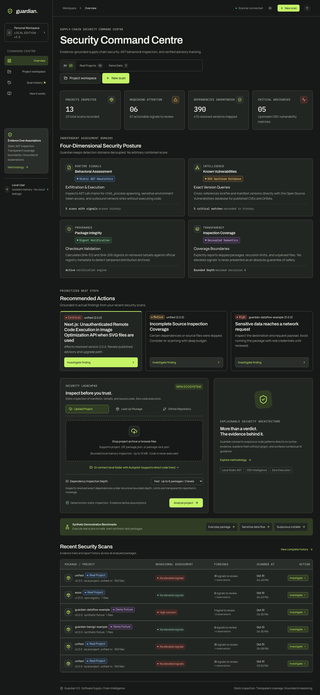
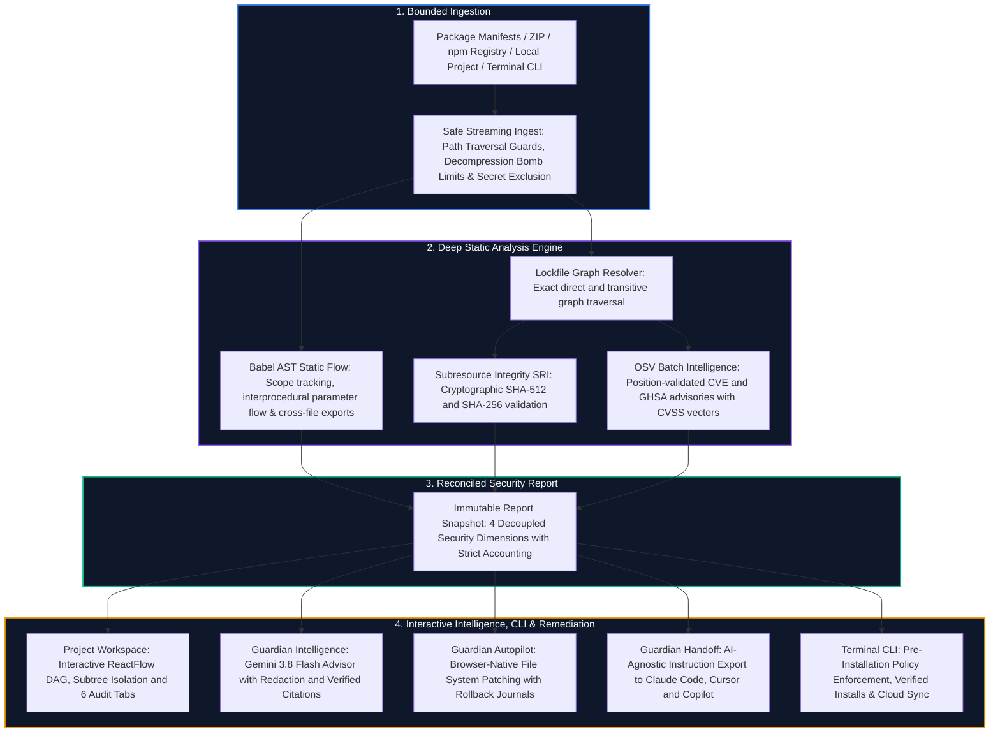
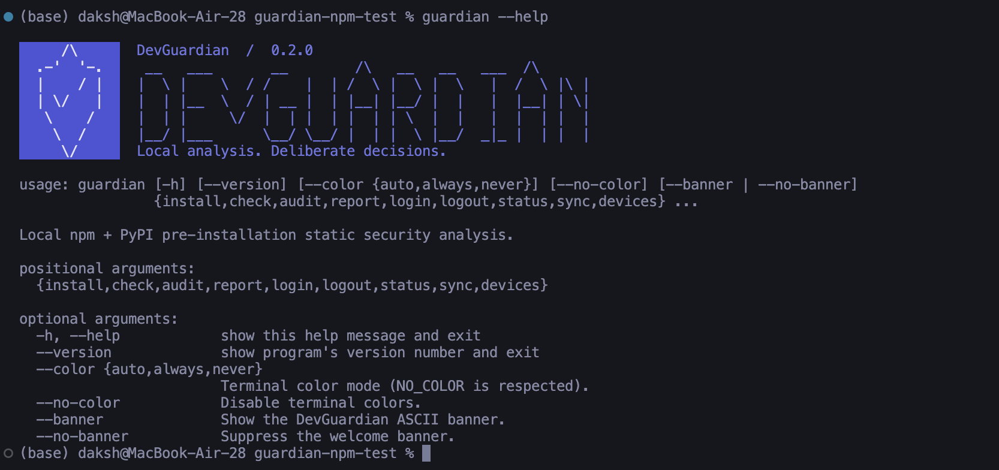
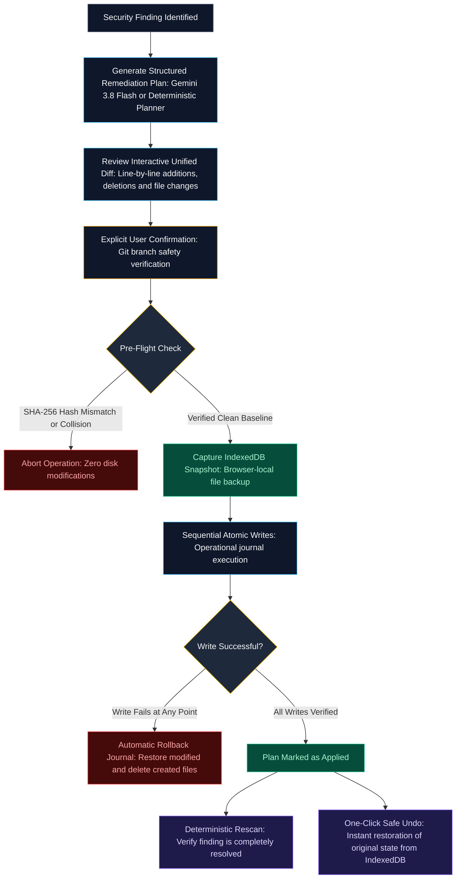
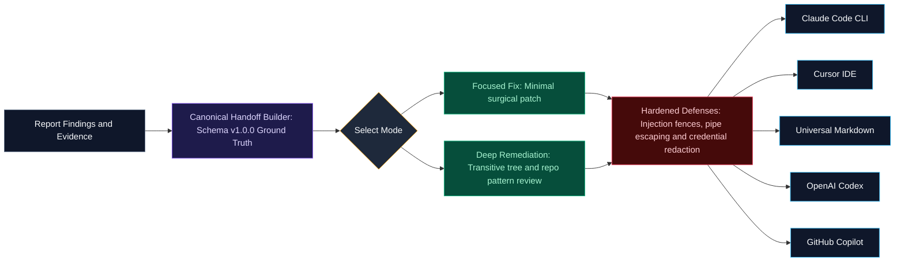
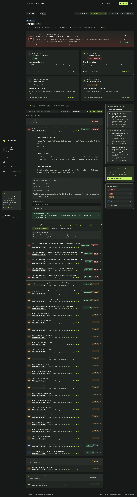

<div align="center">

# 🛡️ Guardian

### **Know What You Trust.**
**Next-Generation Supply-Chain Intelligence, Static Data-Flow Analysis & In-Browser Autonomous Remediation**

[](https://nextjs.org/)
[](https://react.dev/)
[](https://www.typescriptlang.org/)
[](https://fastapi.tiangolo.com/)
[](https://deepmind.google/technologies/gemini/)
[](docs/CLI.md)
[](docs/ACCOUNTS-DEPLOYMENT.md)
[](https://github.com)

<br/>

<p align="center">
  <b>Guardian is an evidence-first security platform for npm and PyPI packages.</b><br/>
  It maps full dependency trees, verifies cryptographic package integrity (SRI), tracks AST data flows from sensitive sources to network sinks, explains risks with grounded AI, safely patches repositories right inside the browser with rollback journals, and exports hardened prompts to Claude Code, Cursor, and Copilot.
</p>

---



</div>

---

## ⚡ Why Guardian? (The Paradigm Shift)

Traditional SCA tools search for known CVEs in an outdated database. But **supply-chain attacks don't wait for a CVE**—malicious maintainer takeovers, typosquatted packages, sensitive token exfiltration, and malicious `postinstall` hooks strike immediately.

| Traditional SCA Tools | The Guardian Platform |
|:---|:---|
| ❌ **Black-box single score** (e.g. "88/100 Safe") | 🎯 **Decoupled 4D Posture**: Behavioral, OSV, SRI, and Coverage evaluated independently |
| ❌ **Vulnerability lists only**: Misses zero-day behavioral malware | 🔬 **Deterministic Static Data-Flow Engine**: Traces secrets from source to sink across files |
| ❌ **Post-install panic**: Alerts you after malicious code ran on your laptop | 💻 **Pre-Installation CLI Enforcement**: Blocks malicious packages before they touch disk |
| ❌ **Cloud-first exposure**: Uploads your private source code | 🔒 **100% Local-First Privacy**: AST analysis in-memory; source code never leaves your machine |
| ❌ **Blind trust**: Executes install scripts in containers | 🛡️ **Zero Arbitrary Execution**: Scripts and tarballs are never executed |
| ❌ **Manual fix slog**: Leaves developers stuck fixing files | 🚀 **Guardian Autopilot**: In-browser local patching with IndexedDB rollback snapshots |
| ❌ **Prompt drift**: Copy-pasting raw CVEs into ChatGPT | 🤖 **Guardian Handoff**: Hardened, injection-defended exports for Claude Code & Cursor |
| ❌ **Siloed tools**: Terminal disconnected from web reports | ☁️ **Seamless Cloud Sync**: Device PKCE auth with optional sanitized dashboard sync |

---

## 🌟 Superpowers & Killer Features



---

### 1. 🔍 Deep AST Data-Flow Engine (Zero-Execution Leak Detection)
Guardian doesn't just scan for regex keywords. It utilizes a trusted Babel AST front-end and a Python static engine that builds a real syntax tree to trace variables:
* **Source-to-Sink Tracking**: Tracks tokens like `process.env.AWS_SECRET_ACCESS_KEY` or `process.env.NPM_TOKEN` through variable reassignments, parameter passing, and object destructuring until they hit a network sink (`fetch()`, `https.request()`, `axios()`).
* **Cross-File Data Flow**: Resolves static ES Module (`import`/`export`) and CommonJS (`require`/`module.exports`) imports to follow data across project boundaries.
* **Exact Evidence**: Pinpoints the exact line, column, syntax snippet, and binding chain.

---

### 2. 💻 Local-First Terminal CLI (Pre-Installation Enforcement)
> **Catch threats at the front door before `npm install` or `pip install` compromises your workstation.**

The **`guardian`** CLI brings Guardian’s full static analysis and verification engine directly to developer workflows in the terminal:

<div align="center">



</div>

* **Pre-Installation Verification**: Run `guardian install <pkg>` instead of standard package managers. Guardian downloads tarballs or wheels in-memory, verifies cryptographic hashes, inspects the dependency graph, and analyzes AST data flows **before** anything touches your disk.
* **Dual-Ecosystem (npm & PyPI)**: Full support for JavaScript/TypeScript (`package-lock.json` v2/v3) and Python (`requirements.txt`, PEP 440/503/621 wheels).
* **Script-Free Verified Installations**: Disables lifecycle hooks (`preinstall`, `postinstall`) completely. Populates an isolated verified cache and performs atomic staging into `node_modules` or Python virtual environments.
* **Deterministic Policy Gate**: Evaluates outcomes as `ALLOW`, `WARN`, `BLOCK`, or `REVIEW`. Malicious code evaluation, credential exfiltration, or typosquats are immediately blocked.
* **Offline Inspection**: Inspect local packages (`guardian check ./dist.tgz --offline`) with zero network dependency.

```sh
# Pre-install inspection and safe, script-free installation
guardian install express                      # npm project: verified script-free install
guardian install requests                     # PyPI project: hash-pinned wheel install
guardian check npm:lodash@4.17.21             # Inspect package without installing
guardian audit                                # Audit current project source + dependencies
guardian report --output scan.json            # Export atomic local JSON report
```

---

### 3. ☁️ Seamless Cloud Sync & Web Federation (Supabase PKCE)
> **Bridge your local terminal with the full power of the web dashboard—privately and on your terms.**

Guardian provides an optional, privacy-respecting synchronization bridge connecting the CLI and the web application:

```mermaid
flowchart LR
    A["Developer Terminal: guardian audit / install"] --> B["Local Private Report: SQLite / In-Memory"]
    B --> C["Explicit User Sync: guardian sync"]
    C --> D["Automated Secret Redaction: Strips API keys, passwords & private source"]
    D --> E["Supabase Auth API: PKCE Token Verification with GitHub Identity"]
    E --> F["Guardian Web Command Centre: Live Project Workspace & DAG Explorer"]

    style A fill:#0f172a,stroke:#64748b,color:#f8fafc
    style B fill:#0f172a,stroke:#38bdf8,color:#f8fafc
    style C fill:#1e293b,stroke:#f59e0b,color:#f8fafc
    style D fill:#450a0a,stroke:#f43f5e,color:#fecdd3
    style E fill:#064e3b,stroke:#10b981,color:#a7f3d0
    style F fill:#1e1b4b,stroke:#8b5cf6,color:#ddd6fe
```



* **Device-Bound PKCE Authorization**: Run `guardian login` in the terminal to launch a browser-based GitHub OAuth flow via Supabase. Credentials are saved directly into your system's secure OS keychain (macOS Keychain, Linux SecretService, Windows Credential Manager).
* **Explicit, Sanitized Synchronization**: Guardian **never** syncs automatically. Scans stay local until you explicitly run `guardian sync`. Reports are sanitized—all sensitive credentials and proprietary code are redacted before upload.
* **Integrated Web Inspection**: CLI scans immediately surface in the web dashboard under your authenticated profile. Jump straight from a terminal warning into the interactive DAG or launch Guardian Autopilot to remediate it.
* **Offline CLI Report Import**: Air-gapped or offline? Export reports with `guardian report --json` and drag-and-drop the file into the web UI using the built-in **CLI Report Import** bridge.

---

### 4. 🛠️ Guardian Autopilot (Safe In-Browser AI Remediation)
> **The world's first browser-native supply chain remediation system with ironclad rollback safety.**

When an issue is identified, Guardian doesn't just tell you to fix it—it fixes it for you directly in your browser using the modern **File System Access API**, backed by a multi-tier safety architecture:



* **Local Browser Handles**: Source files remain in browser memory (`window.showDirectoryPicker`). No server uploads.
* **Verbatim Text Edits**: Edits require unique text anchors and exact before/after matching.
* **Pre-Flight SHA-256 Verification**: Verifies disk contents match the snapshot before touching a single byte.
* **Instant IndexedDB Recovery**: Before any change is written, full file bytes are snapshotted in IndexedDB for 1-click atomic rollback.

---

### 5. 🤖 Guardian Handoff (AI-Agnostic Agent Instructions)
Prefer handing off remediation to an autonomous CLI agent or your favorite IDE assistant? Guardian Handoff deterministically compiles security findings into hardened, prompt-injection-defended instruction packages:



* **5 Tailored Agent Adapters**: Universal Markdown, Claude Code, Cursor, OpenAI Codex, and GitHub Copilot.
* **Dual Modes**: **Focused Fix** (minimal, zero-regression patch) vs **Deep Security Remediation** (transitive audits, lockfile verification, and repo-wide pattern scans).
* **Adversarial Defenses**: Dynamic backtick scaling, markdown pipe escaping, and strict instructions directing receiving agents to treat scanner evidence as untrusted data.
* **Machine-Readable JSON Appendix**: Appends schema-validated JSON with exact advisory IDs, CVSS vectors, and dependency paths.

---

### 6. 🧠 Guardian Intelligence (Contextual Security Advisor)
* **Persistent Collapsible Drawer**: Slides in smoothly alongside any scan report or investigation tab.
* **Powered by Gemini 3.8 Flash**: Fast, nuanced reasoning powered by Google DeepMind's official `google-genai` SDK.
* **Strict Anti-Hallucination Guardrails**: Every advisory citation generated by the AI is mathematically validated against genuine report findings. Citations are interactive buttons that highlight and jump directly to the finding in the report.
* **Automated Privacy Redaction**: Automatically scrubs API keys, private keys, auth headers, and tokens before transmitting context.

---

### 7. 🕸️ Project Investigation Workspace (6 Dedicated Views)
A state-of-the-art interactive workspace engineered with **`@xyflow/react`** and **`@dagrejs/dagre`**:



1. **Overview**: Framework detection (Next.js, Vite, Jest, Express), package stats, and scan deltas.
2. **Interactive Dependency Graph**: Hierarchical zoomable DAG with search, severity filtering, depth controls, and focused subtree isolation.
3. **Vulnerabilities Explorer**: Package-first tree mapping direct/transitive dependencies to published OSV advisories.
4. **Behavioral Flows**: Visual step-by-step trace showing source, assignment, parameter, and sink progression.
5. **Remediation History**: Audit log of all applied plans, approvals, undos, and rescan verification outcomes.
6. **Security Timeline**: Multi-scan posture tracking across commits with side-by-side delta comparisons.

---

## 🚀 Quick Local Setup

Want to run the full stack locally? It takes less than 2 minutes.

### 1. Clone & Install
```sh
cd Guardian
npm ci --ignore-scripts
python3 -m venv .venv
.venv/bin/pip install -r backend/requirements.txt
.venv/bin/pip install --no-deps -e .   # Install guardian CLI executable
```

### 2. Launch
Start the backend:
```sh
.venv/bin/python -m uvicorn backend.guardian.main:app --host 127.0.0.1 --port 8000
```

Start the frontend:
```sh
npm run dev
```

Open **[http://127.0.0.1:3000](http://127.0.0.1:3000)**.  
*(Optional: set `GUARDIAN_AI_ENABLED=true` and `GEMINI_API_KEY=your_key` to activate the Gemini security advisor).*

---

## 🔒 Ironclad Security Guardrails

* **Zero Arbitrary Execution**: Guardian never runs package scripts (`preinstall`, `postinstall`), never executes uploaded archives, and never runs untrusted code in an unmonitored sandbox.
* **Privacy-First Boundaries**: Ingestion runs in-memory; local project handles remain in browser memory; API keys and sensitive tokens are automatically redacted.
* **Reconciled Accounting Invariants**:
  $$\text{declaredDirect} + \text{transitive} = \text{totalResolved}$$
  $$\text{inspected} + \text{skipped} + \text{unavailable} + \text{unresolved} + \text{integrity\_failed} + \text{not\_attempted} = \text{totalResolved}$$
* **Fail Visibly**: Incomplete coverage, skipped dependencies, or API outages are always surfaced visibly—never concealed.

---

## 📚 Deep-Dive Documentation

* 📐 [Architecture Specification](ARCHITECTURE.md) — System modules, data flow, concurrency, and API contracts
* 🛡️ [Detection Rules Reference](DETECTION_RULES.md) — Rule IDs, severity classifications, and AST matchers
* 📋 [Product Requirements Document](PRD.md) — User personas, design contracts, and product vision
* 💻 [CLI & Offline Installation Guide](docs/CLI.md) — Pre-installation CLI, lockfile pinning, and cache mechanics
* ☁️ [Accounts, Sync & Cloud Deployment](docs/ACCOUNTS-DEPLOYMENT.md) — Supabase PKCE login, report sync, and Render/Vercel setup
* 🗺️ [Project Roadmap](ROADMAP.md) — MicroVM sandboxes, multi-ecosystem expansion, and roadmap milestones

---

<div align="center">
  <sub>Built with precision for developers and security engineers who value verifiable truth over black-box scores.</sub>
</div>
